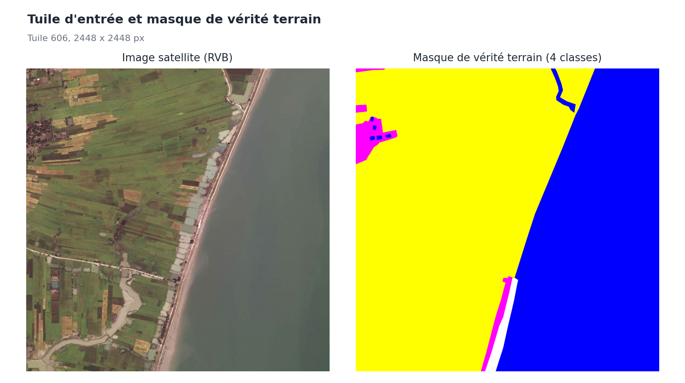
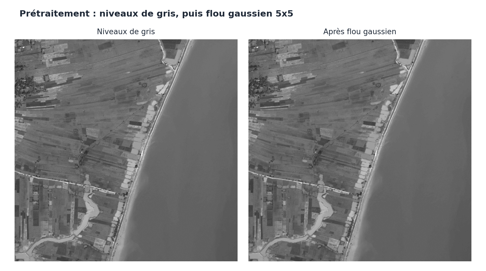
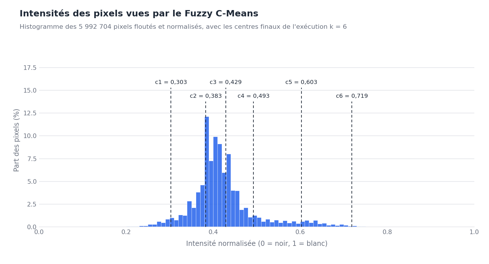
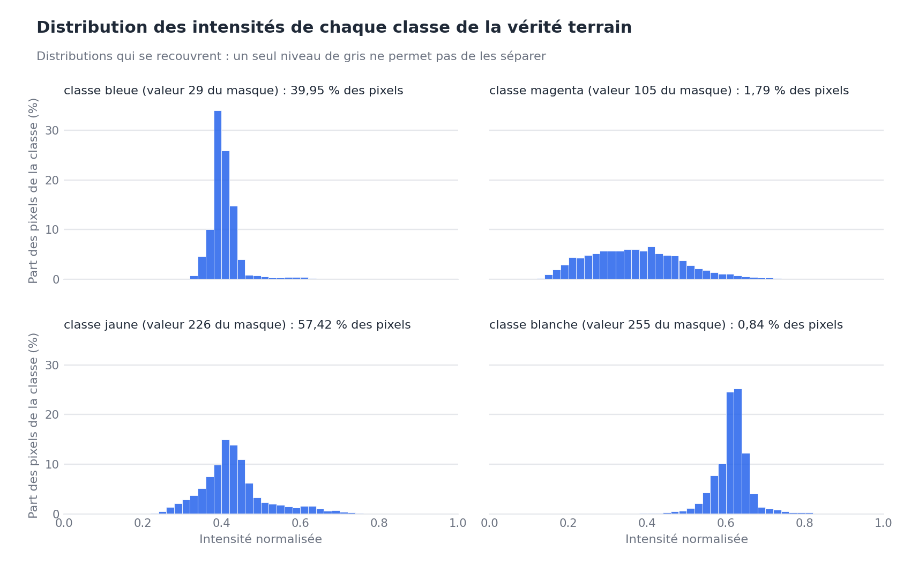
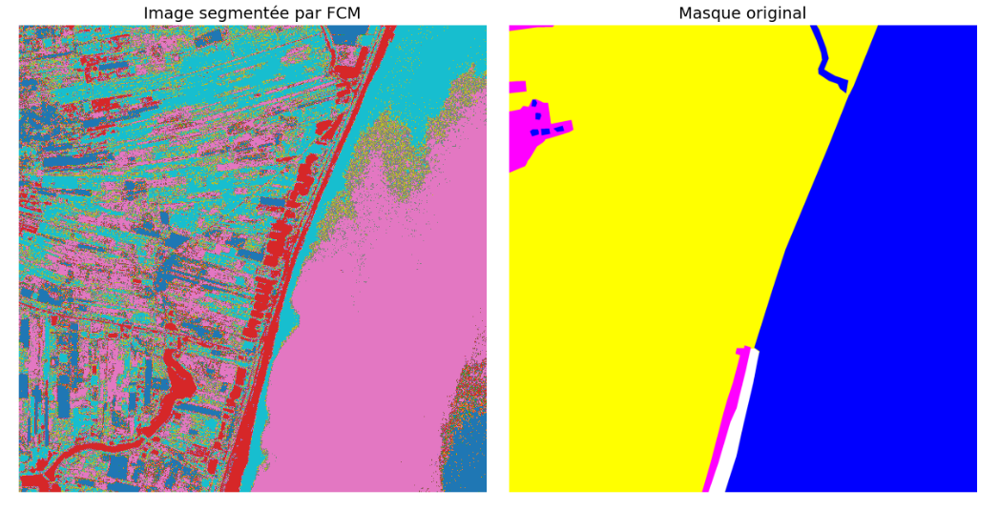
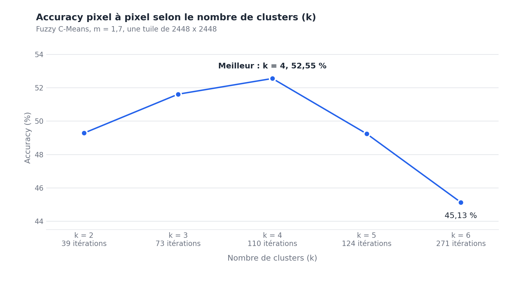
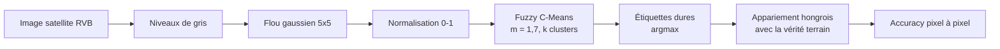

<h1 align="center">Segmentation d'images satellitaires par Fuzzy C-Means</h1>

<p align="center">
  Segmentation non supervisée d'images satellitaires par clustering flou : implémentation Python de l'algorithme <b>Fuzzy C-Means</b> écrite à partir de zéro, évaluée sur un masque de vérité terrain.<br>
  <b>Mémoire de Master 2, 2025</b> : Intelligence Artificielle et ses Applications, USTO-MB (Oran, Algérie).
</p>

<p align="center">
  <a href="README.md">🇬🇧 English</a> · 🇫🇷 Français
</p>

<p align="center">
  
  
  
  
  
  
  
  
</p>

> 🎓 **Projet de fin d'études de Master 2, réalisé en 2025.** Ce dépôt est la partie pratique de mon mémoire de Master *« Segmentation d'images satellitaires par la méthode Fuzzy C-Means »* (Master 2, Intelligence Artificielle et ses Applications, année universitaire 2024/2025, soutenu en mai 2025). Voir [Contexte académique](#contexte-académique).

---

## Présentation

Les images satellitaires sont riches mais difficiles à interpréter : les frontières entre types de sol sont rarement nettes, et les données d'entraînement étiquetées coûtent cher. Ce projet étudie le **Fuzzy C-Means (FCM)**, un algorithme de **machine learning non supervisé fondé sur la logique floue**, dans lequel chaque pixel appartient à chaque cluster avec un **degré d'appartenance** entre 0 et 1, au lieu d'être forcé dans une seule classe comme avec le K-Means.

Le travail couvre toute la démarche scientifique : état de l'art sur les satellites, la télédétection et la segmentation d'images ; théorie de la logique floue et du Fuzzy C-Means ; **implémentation NumPy écrite à partir de zéro** ; et étude expérimentale sur une tuile satellite de 2448 × 2448 pixels (**5 992 704 pixels**) avec une vérité terrain au niveau du pixel.

| | |
|---|---|
| **Problème** | Segmenter une image satellite en régions homogènes sans données d'entraînement étiquetées |
| **Approche** | Fuzzy C-Means (clustering flou) sur les intensités en niveaux de gris après flou gaussien |
| **Domaines** | Intelligence artificielle, machine learning, vision par ordinateur, télédétection |
| **Langage / outils** | Python · NumPy · OpenCV · SciPy · scikit-learn · Matplotlib · Jupyter |
| **Évaluation** | Accuracy pixel à pixel après appariement optimal (hongrois) des étiquettes, pour k = 2 … 6 |
| **Meilleur réglage** | k = 4 clusters → accuracy de **52,55 %** |

### Motivation

Les satellites d'observation de la Terre produisent d'énormes volumes d'images utilisées en agriculture, foresterie, urbanisme, suivi du climat et gestion des catastrophes. Transformer les pixels bruts en régions (eau, champs, zones bâties, sols nus) est la première étape de la plupart de ces applications. Les méthodes supervisées exigent de grands jeux de données annotés ; le **clustering non supervisé** n'en demande aucun. Et comme les frontières naturelles sont progressives (un littoral, le bord d'une culture, une ombre), une affectation **souple** est plus fidèle qu'une affectation dure.

### Objectifs

1. Comprendre et documenter les **fondements** : satellites, capteurs, télédétection, segmentation d'images, logique floue.
2. **Implémenter le Fuzzy C-Means à partir de zéro** et le valider sur une image synthétique.
3. **L'appliquer à une tuile satellite réelle** et **mesurer** le résultat sur une vérité terrain au niveau du pixel.
4. **Étudier l'influence du nombre de clusters** `k` sur la convergence, l'accuracy et la qualité visuelle.
5. **Identifier les limites** de l'approche et les pistes pour l'améliorer.

### Chiffres clés

| | |
|---|---|
| Taille de l'image | 2448 × 2448 px = **5 992 704 pixels** |
| Classes de vérité terrain | **4** (la plus grande : 57,42 % des pixels) |
| Clusters testés | k = 2, 3, 4, 5, 6 |
| Indice de flou / tolérance | m = 1,7 / ε = 1e-5 |
| Itérations jusqu'à convergence | de **39** (k = 2) à **271** (k = 6) |
| Meilleure accuracy | **52,55 %** (k = 4) |
| Code | un notebook principal (NumPy vectorisé) + 3 expériences préliminaires |
| Documentation | 4 documents, en français et en anglais |

## Parcours visuel

Les figures suivantes suivent une exécution de la chaîne de traitement sur la tuile 606.

### 1. L'entrée : une tuile satellite et sa vérité terrain

<p align="center">
  
</p>

Des terres agricoles à gauche, une grande étendue d'eau à droite, une fine bande côtière entre les deux. Le masque comporte quatre classes colorées : bleue (39,95 %), jaune (57,42 %), magenta (1,79 %) et blanche (0,84 %).

### 2. Prétraitement : niveaux de gris et flou gaussien

<p align="center">
  
</p>

La tuile RVB est réduite à une intensité par pixel, puis lissée avec un noyau gaussien 5 × 5 pour atténuer le bruit en conservant les contours principaux. Les intensités vont alors de 24 à 254 et sont normalisées dans [0, 1].

### 3. Ce que le Fuzzy C-Means voit réellement

<p align="center">
  
</p>

L'algorithme regroupe **un seul nombre par pixel**. L'histogramme montre un pic dominant autour de 0,4 et une longue queue vers les valeurs claires ; les traits pointillés sont les six centres trouvés pour k = 6 (convergence après 271 itérations). Plusieurs centres tombent dans le pic principal, ce qui explique l'aspect moucheté des régions.

### 4. Pourquoi l'accuracy est limitée : les classes se recouvrent en intensité

<p align="center">
  
</p>

Les deux plus grandes classes ont presque la même intensité moyenne (**0,408** pour la classe bleue, **0,434** pour la jaune) : une seule valeur de gris ne peut donc pas les séparer de façon fiable. C'est la principale raison structurelle de l'accuracy modeste, au-delà de l'algorithme lui-même.

### 5. Le résultat face à la vérité terrain (k = 4)

<p align="center">
  
</p>

L'étendue d'eau et le littoral sont retrouvés ; les terres agricoles sont fragmentées en nombreuses petites régions, car leurs intensités recouvrent celles d'autres classes. *(Capture issue d'une exécution d'expérience.)*

> Les images des figures proviennent de la tuile 606 d'un jeu de données public d'occupation des sols, distribué sous licence MIT (voir [`data/README.md`](data/README.md)).

### Ce que ce projet démontre

- **Fondamentaux du machine learning** : apprentissage non supervisé, clustering flou, optimisation d'une fonction objectif, analyse de la convergence.
- **Implémentation d'algorithmes** : traduire les mathématiques en NumPy vectorisé capable de traiter six millions d'échantillons.
- **Vision par ordinateur et télédétection** : prétraitement d'images, segmentation, manipulation d'imagerie satellitaire.
- **Rigueur expérimentale** : évaluation sur vérité terrain, appariement optimal des étiquettes, étude de paramètres et analyse honnête des limites de la métrique.
- **Communication scientifique** : un mémoire structuré et une documentation technique bilingue.

## Points forts

- **Fuzzy C-Means implémenté à partir de zéro**, d'abord avec des boucles sur les pixels, puis **vectorisé avec NumPy** pour traiter ~6 millions de pixels.
- **Chaîne de prétraitement** complète : conversion en niveaux de gris, flou gaussien, normalisation.
- **Évaluation quantitative** sur un masque de vérité terrain avec l'algorithme hongrois (`scipy.optimize.linear_sum_assignment`).
- **Étude systématique du nombre de clusters** (k = 2 à 6) : vitesse de convergence, accuracy et qualité visuelle.
- **Discussion honnête** des limites de la méthode (bruit, initialisation aléatoire, une seule caractéristique d'intensité) et des réserves sur la métrique.
- Documentation détaillée de la théorie, de la méthode et des résultats, en français et en anglais.

## Résultats

Segmentation d'une tuile satellite de 2448 × 2448 pixels, m = 1,7, ε = 1e-5 :

| k | 2 | 3 | **4** | 5 | 6 |
|---|---|---|---|---|---|
| Itérations | 39 | 73 | 110 | 124 | 271 |
| Accuracy (%) | 49,28 | 51,61 | **52,55** | 49,24 | 45,13 |

<p align="center">
  
</p>

| k = 4 (meilleur) | k = 6 |
|:---:|:---:|
|  |  |

**Lecture des résultats**

- **k = 4 donne le meilleur compromis** entre séparation des régions et fragmentation. Trop peu de clusters fusionnent des zones distinctes ; trop de clusters scindent des zones homogènes et exigent bien plus d'itérations pour converger.
- L'accuracy est **modeste**, et le mémoire le reconnaît. Les causes : l'usage d'**une seule caractéristique en niveaux de gris**, l'absence de **contexte spatial** et l'**initialisation aléatoire**.
- L'accuracy pixel à pixel est ici un indicateur grossier : le masque compte 4 classes dont la plus grande couvre 57,42 % de l'image, et avec k > 4 un appariement un-pour-un laisse des clusters sans correspondance par construction. Détails dans [`docs/fr/results.md`](docs/fr/results.md).

## Fonctionnement



Le Fuzzy C-Means alterne deux mises à jour jusqu'à ce que la matrice d'appartenance se stabilise :

$$
c_i=\frac{\sum_j u_{ij}^m x_j}{\sum_j u_{ij}^m}
\qquad
u_{ij}=\frac{1}{\sum_{k}\left(\frac{\lVert x_j-c_i\rVert}{\lVert x_j-c_k\rVert}\right)^{\frac{2}{m-1}}}
$$

où $u_{ij}$ est le degré d'appartenance du pixel $j$ au cluster $i$, $c_i$ le centre du cluster et $m$ l'indice de flou. Voir [`docs/fr/theory.md`](docs/fr/theory.md).

## Structure du dépôt

```
satellite-fuzzy-segmentation/
├── notebooks/
│   └── fuzzy_c_means_satellite_segmentation.ipynb   expérience principale (FCM vectorisé + évaluation)
├── experiments/                                     expériences préliminaires (premières implémentations)
│   ├── 01_fcm_from_scratch_small_image.ipynb
│   ├── 02_fcm_scikit_fuzzy_synthetic_image.ipynb
│   └── 03_fcm_scikit_fuzzy_script.py
├── docs/
│   ├── theory.md  methodology.md  results.md  background.md
│   ├── fr/                                          versions françaises
│   └── figures/                                     figures de résultats
├── assets/synthetic_shapes.png                      image synthétique de test
├── data/README.md                                   comment obtenir les données d'entrée
├── requirements.txt
└── LICENSE
```

## Démarrage rapide

```bash
git clone https://github.com/aminehemmaz/satellite-fuzzy-segmentation.git
cd satellite-fuzzy-segmentation
python -m venv .venv
# Windows : .venv\Scripts\activate      Linux / macOS : source .venv/bin/activate
pip install -r requirements.txt
```

1. Placer l'image d'entrée et son masque dans `data/` (voir [`data/README.md`](data/README.md), en anglais).
2. Lancer `jupyter lab` et ouvrir `notebooks/fuzzy_c_means_satellite_segmentation.ipynb`.
3. Exécuter toutes les cellules. Pour reproduire l'étude, changer `k` (de 2 à 6) et relancer.

> L'initialisation des appartenances est **aléatoire et sans graine** : le nombre d'itérations et l'accuracy varient légèrement d'une exécution à l'autre. L'exécution en pleine résolution demande quelques Go de RAM.

## Documentation

| Document | Contenu |
|---|---|
| [Théorie](docs/fr/theory.md) | Logique floue, ensembles flous, Fuzzy C-Means, comparaison avec le K-Means |
| [Méthodologie](docs/fr/methodology.md) | Données, prétraitement, paramètres, évaluation, reproductibilité |
| [Résultats](docs/fr/results.md) | Tableaux, cartes de segmentation, discussion et réserves |
| [Contexte](docs/fr/background.md) | Satellites, capteurs, télédétection, classification et segmentation |

## Limites

- **Une seule caractéristique** : seule l'intensité en niveaux de gris est utilisée, sans bandes de couleur, texture ni voisinage ; les classes aux intensités qui se recouvrent ne peuvent donc pas être séparées.
- **Initialisation aléatoire** et **nombre de clusters fixé à l'avance**.
- **Une seule image** a été évaluée : les conclusions sont indicatives, pas statistiques.
- Le titre du mémoire évoque une approche *hybride* ; la méthode **implémentée** est le **Fuzzy C-Means standard**. L'hybridation est proposée comme travail futur.

## Perspectives

Extensions identifiées dans le mémoire :

- **Hybridation K-Means + Fuzzy C-Means** : utiliser le K-Means pour initialiser les centres et stabiliser le point de départ.
- **Hybridation Fuzzy C-Means + CNN** (apprentissage profond) pour profiter de caractéristiques apprises.

Suites naturelles : variantes du FCM intégrant l'espace, caractéristiques multispectrales ou de couleur, métriques par classe (IoU, F1), évaluation sur plusieurs tuiles.

## Mots-clés

`intelligence artificielle` · `machine learning` · `apprentissage non supervisé` · `clustering` · `clustering flou` · `logique floue` · `fuzzy c-means` · `soft computing` · `vision par ordinateur` · `segmentation d'images` · `traitement d'images` · `télédétection` · `imagerie satellitaire` · `observation de la Terre` · `occupation des sols` · `Python` · `NumPy` · `OpenCV` · `Jupyter`

## Références

- L. A. Zadeh, *Fuzzy sets*, Information and Control, 8(3), 1965.
- J. C. Bezdek, *Pattern Recognition with Fuzzy Objective Function Algorithms*, Plenum Press, 1981.
- W. G. Rees, *Physical Principles of Remote Sensing*, Cambridge University Press, 2001.
- T. M. Lillesand et R. W. Kiefer, *Remote Sensing and Image Interpretation*, Wiley.
- J. A. Richards, *Remote Sensing Digital Image Analysis*, Springer, 1993.
- I. Demir *et al.*, *DeepGlobe 2018: A Challenge to Parse the Earth through Satellite Images*, CVPR Workshops, 2018.

La bibliographie complète figure dans la [documentation](docs/fr/).

## Contexte académique

| | |
|---|---|
| **Type** | Mémoire de fin d'études de Master 2 : le projet et ses expériences |
| **Diplôme** | Master en Informatique, spécialité **Intelligence Artificielle et ses Applications** |
| **Établissement** | Faculté des Mathématiques et d'Informatique, Département d'Informatique, Université des Sciences et de la Technologie d'Oran Mohamed Boudiaf (**USTO-MB**), Algérie |
| **Année universitaire** | 2024/2025 |
| **Soutenance** | Mai 2025 |
| **Titre du mémoire** | *Segmentation d'images satellitaires par la méthode Fuzzy C-Means* |

**Structure du mémoire** (77 pages, quatre chapitres) et où le retrouver dans ce dépôt :

| Chapitre | Contenu | Dans ce dépôt |
|---|---|---|
| 1. Généralités sur les satellites | Satellites, orbites, capteurs, télédétection | [`docs/fr/background.md`](docs/fr/background.md) |
| 2. Imagerie satellitaire | Caractéristiques, prétraitement, classification, segmentation | [`docs/fr/background.md`](docs/fr/background.md) |
| 3. Approche Fuzzy C-Means | Logique floue, algorithme, comparaison avec le K-Means | [`docs/fr/theory.md`](docs/fr/theory.md) |
| 4. Implémentations et résultats | Implémentation Python, expériences, évaluation, choix de k | [`notebooks/`](notebooks), [`docs/fr/methodology.md`](docs/fr/methodology.md), [`docs/fr/results.md`](docs/fr/results.md) |

Le mémoire complet n'est **pas** publié ici ; ce dépôt contient le code et un résumé documenté du travail.

## Licence

Le code et la documentation sont publiés sous [licence MIT](LICENSE). Les images d'entrée ne font **pas** partie de ce dépôt ; le jeu de données est distribué sous sa propre licence MIT (voir [`data/README.md`](data/README.md)).
