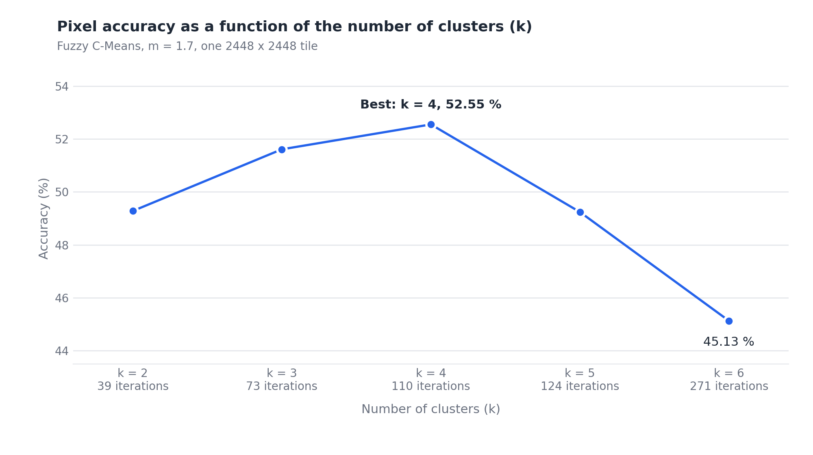
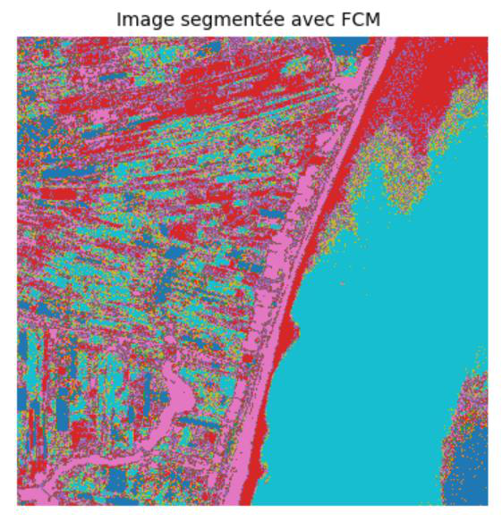
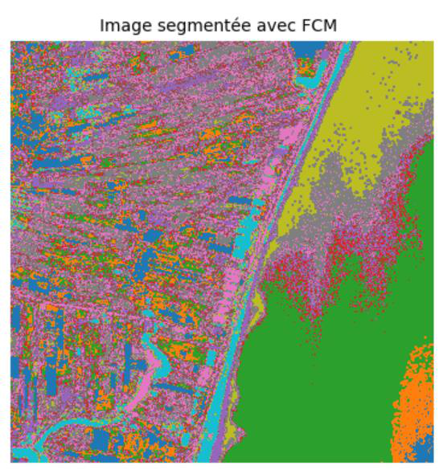

<h1 align="center">Satellite Image Segmentation with Fuzzy C-Means</h1>

<p align="center">
  Unsupervised, soft-clustering segmentation of satellite imagery: a from-scratch Python implementation of the <b>Fuzzy C-Means</b> algorithm, evaluated against a ground-truth mask.<br>
  <b>Master 2 thesis, 2025</b>: Artificial Intelligence and its Applications, USTO-MB (Oran, Algeria).
</p>

<p align="center">
  🇬🇧 English · <a href="README.fr.md">🇫🇷 Français</a>
</p>

<p align="center">
  
  
  
  
  
  
  
  
</p>

> 🎓 **Master 2 final-year project, completed in 2025.** This repository is the practical part of my Master's thesis *"Segmentation d'images satellitaires par la méthode Fuzzy C-Means"* (Master 2, Artificial Intelligence and its Applications, academic year 2024/2025, defended in May 2025). See [Academic context](#academic-context).

---

## Overview

Satellite images are rich but hard to interpret: land-cover boundaries are rarely sharp, and labelled training data is expensive. This project studies **Fuzzy C-Means (FCM)**, a **fuzzy-logic-based unsupervised machine-learning** algorithm in which every pixel belongs to every cluster with a **degree of membership** between 0 and 1, instead of being forced into a single class as in K-Means.

The work covers the full scientific pipeline: state of the art on satellites, remote sensing and image segmentation; theory of fuzzy logic and Fuzzy C-Means; a **NumPy implementation written from scratch**; and an experimental study on a 2448 × 2448 satellite tile (**5,992,704 pixels**) with a pixel-level ground truth.

| | |
|---|---|
| **Problem** | Segment a satellite image into homogeneous regions without labelled training data |
| **Approach** | Fuzzy C-Means (soft clustering) on Gaussian-blurred grayscale intensities |
| **Domains** | Artificial intelligence, machine learning, computer vision, remote sensing |
| **Language / stack** | Python · NumPy · OpenCV · SciPy · scikit-learn · Matplotlib · Jupyter |
| **Evaluation** | Pixel accuracy after optimal (Hungarian) label matching, for k = 2 … 6 |
| **Best setting** | k = 4 clusters → **52.55 %** accuracy |

## Highlights

- **Fuzzy C-Means implemented from scratch**, first with pixel loops, then **vectorised with NumPy** so it runs on ~6 million pixels.
- Complete **pre-processing chain**: grayscale conversion, Gaussian blur, normalisation.
- **Quantitative evaluation** against a ground-truth mask with the Hungarian algorithm (`scipy.optimize.linear_sum_assignment`).
- **Systematic study of the number of clusters** (k = 2 to 6): convergence speed, accuracy and visual quality.
- **Honest discussion** of the limits of the method (noise, random initialisation, intensity-only features), with the caveats of the metric.
- Detailed documentation of the theory, the method and the results, in English and French.

## Results

Segmentation of a 2448 × 2448 satellite tile, m = 1.7, ε = 1e-5:

| k | 2 | 3 | **4** | 5 | 6 |
|---|---|---|---|---|---|
| Iterations | 39 | 73 | 110 | 124 | 271 |
| Accuracy (%) | 49.28 | 51.61 | **52.55** | 49.24 | 45.13 |

<p align="center">
  
</p>

| k = 4 (best) | k = 6 |
|:---:|:---:|
|  |  |

**Reading the results**

- **k = 4 gives the best compromise** between region separation and fragmentation. Too few clusters merge distinct zones; too many split homogeneous ones and need far more iterations to converge.
- The accuracy is **modest**, and the thesis says so. The reasons are the use of a **single grayscale feature**, the absence of **spatial context** and the **random initialisation**.
- Pixel accuracy is a coarse metric here: the mask has 4 classes and the largest covers 57.42 % of the image, and with k > 4 a one-to-one matching leaves clusters unmatched by construction. Details in [`docs/results.md`](docs/results.md).

## How it works


Fuzzy C-Means alternates two updates until the membership matrix stops changing:

$$
c_i=\frac{\sum_j u_{ij}^m x_j}{\sum_j u_{ij}^m}
\qquad
u_{ij}=\frac{1}{\sum_{k}\left(\frac{\lVert x_j-c_i\rVert}{\lVert x_j-c_k\rVert}\right)^{\frac{2}{m-1}}}
$$

where $u_{ij}$ is the degree of membership of pixel $j$ to cluster $i$, $c_i$ the centroid and $m$ the fuzziness index. See [`docs/theory.md`](docs/theory.md).

## Repository structure

```
satellite-fuzzy-segmentation/
├── notebooks/
│   └── fuzzy_c_means_satellite_segmentation.ipynb   main experiment (vectorised FCM + evaluation)
├── experiments/                                     preliminary experiments (first implementations)
│   ├── 01_fcm_from_scratch_small_image.ipynb
│   ├── 02_fcm_scikit_fuzzy_synthetic_image.ipynb
│   └── 03_fcm_scikit_fuzzy_script.py
├── docs/
│   ├── theory.md  methodology.md  results.md  background.md
│   ├── fr/                                          French versions
│   └── figures/                                     result figures
├── assets/synthetic_shapes.png                      synthetic test image
├── data/README.md                                   how to obtain the input data
├── requirements.txt
└── LICENSE
```

## Quick start

```bash
git clone https://github.com/aminehemmaz/satellite-fuzzy-segmentation.git
cd satellite-fuzzy-segmentation
python -m venv .venv
# Windows: .venv\Scripts\activate      Linux / macOS: source .venv/bin/activate
pip install -r requirements.txt
```

1. Put the input image and its mask in `data/` (see [`data/README.md`](data/README.md)).
2. Launch `jupyter lab` and open `notebooks/fuzzy_c_means_satellite_segmentation.ipynb`.
3. Run all cells. To reproduce the study, change `k` (2 to 6) and run again.

> The membership initialisation is **random and unseeded**: iteration counts and accuracy vary slightly between runs. The full-resolution run needs a few GB of RAM.

## Documentation

| Document | Content |
|---|---|
| [Theory](docs/theory.md) | Fuzzy logic, fuzzy sets, Fuzzy C-Means, comparison with K-Means |
| [Methodology](docs/methodology.md) | Data, pre-processing, parameters, evaluation, reproducibility |
| [Results](docs/results.md) | Tables, segmentation maps, discussion and caveats |
| [Background](docs/background.md) | Satellites, sensors, remote sensing, classification and segmentation |

## Limitations

- **Single feature**: only grayscale intensity is used, with no colour bands, texture or neighbourhood information, so classes with overlapping intensities cannot be separated.
- **Random initialisation** and **number of clusters fixed in advance**.
- **One image** was evaluated, so the conclusions are indicative rather than statistical.
- The thesis title mentions a *hybrid* approach; the **implemented** method is **standard Fuzzy C-Means**. Hybridisation is proposed as future work.

## Perspectives

Extensions identified in the thesis:

- **Hybrid K-Means + Fuzzy C-Means**: use K-Means to initialise the centroids and make the starting point more stable.
- **Hybrid Fuzzy C-Means + CNN** (deep learning) to benefit from learned features.

Natural next steps: spatially-aware FCM variants, multispectral or colour features, class-wise metrics (IoU, F1), evaluation on several tiles.

## Keywords

`artificial intelligence` · `machine learning` · `unsupervised learning` · `clustering` · `soft clustering` · `fuzzy logic` · `fuzzy c-means` · `soft computing` · `computer vision` · `image segmentation` · `image processing` · `remote sensing` · `satellite imagery` · `earth observation` · `land cover` · `Python` · `NumPy` · `OpenCV` · `Jupyter`

## References

- L. A. Zadeh, *Fuzzy sets*, Information and Control, 8(3), 1965.
- J. C. Bezdek, *Pattern Recognition with Fuzzy Objective Function Algorithms*, Plenum Press, 1981.
- W. G. Rees, *Physical Principles of Remote Sensing*, Cambridge University Press, 2001.
- T. M. Lillesand and R. W. Kiefer, *Remote Sensing and Image Interpretation*, Wiley.
- J. A. Richards, *Remote Sensing Digital Image Analysis*, Springer, 1993.
- I. Demir *et al.*, *DeepGlobe 2018: A Challenge to Parse the Earth through Satellite Images*, CVPR Workshops, 2018.

The complete bibliography is in the [documentation](docs/).

## Academic context

| | |
|---|---|
| **Type** | Master 2 final-year thesis (*Mémoire de fin d'études*): the project and its experiments |
| **Degree** | Master in Computer Science, specialty **Artificial Intelligence and its Applications** |
| **Institution** | Faculty of Mathematics and Computer Science, Department of Computer Science, University of Science and Technology of Oran Mohamed Boudiaf (**USTO-MB**), Algeria |
| **Academic year** | 2024/2025 |
| **Defence** | May 2025 |
| **Thesis title** | *Segmentation d'images satellitaires par la méthode Fuzzy C-Means* (written in French) |

**Structure of the thesis** (77 pages, four chapters) and where it lives in this repository:

| Chapter | Content | In this repository |
|---|---|---|
| 1. Generalities on satellites | Satellites, orbits, sensors, remote sensing | [`docs/background.md`](docs/background.md) |
| 2. Satellite imagery | Characteristics, pre-processing, classification, segmentation | [`docs/background.md`](docs/background.md) |
| 3. The Fuzzy C-Means approach | Fuzzy logic, the algorithm, comparison with K-Means | [`docs/theory.md`](docs/theory.md) |
| 4. Implementation and results | Python implementation, experiments, evaluation, choice of k | [`notebooks/`](notebooks), [`docs/methodology.md`](docs/methodology.md), [`docs/results.md`](docs/results.md) |

The full thesis document is **not** published here; this repository contains the code and a documented summary of the work.

## License

The code and documentation are released under the [MIT License](LICENSE). The input images are **not** part of this repository; the dataset is distributed under its own MIT licence (see [`data/README.md`](data/README.md)).
