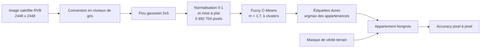

# Méthodologie

[← Retour au README](../../README.fr.md) · [English](../methodology.md)

Ce document décrit le protocole expérimental : données, prétraitement, paramètres de l'algorithme, évaluation et reproductibilité.

## 1. Chaîne de traitement

## 2. Données

* **Image** : une tuile satellite RVB de 2448 × 2448 pixels (tuile *606*), avec des terres agricoles à gauche et une grande étendue d'eau à droite, séparées par un littoral.
* **Vérité terrain** : un masque coloré de même taille, à **4 classes**. Converti en niveaux de gris, il comporte quatre valeurs, avec les parts de pixels suivantes :

| Niveau de gris | Part des pixels | Couleur dans le masque (lecture visuelle) |
|---|---|---|
| 29 | 39,95 % | bleu |
| 105 | 1,79 % | magenta |
| 226 | 57,42 % | jaune |
| 255 | 0,84 % | blanc |

* **Format** : le nommage des tuiles (`<id>_sat.jpg` / `<id>_mask.png`), la taille 2448 × 2448 et la palette de couleurs sont cohérents avec le jeu de données **DeepGlobe Land Cover Classification** (Demir et al., CVPR Workshops 2018). Les images **ne sont pas redistribuées** dans ce dépôt : voir [`data/README.md`](../../data/README.md).
* **Image synthétique** : une image dessinée à la main (cercle, triangle, rectangle sur fond blanc, `assets/synthetic_shapes.png`) utilisée comme test de validité avant le traitement des données réelles.

## 3. Prétraitement

1. **Conversion en niveaux de gris** (`cv2.cvtColor`, BGR → GRAY) : chaque pixel est réduit à une valeur d'intensité.
2. **Flou gaussien**, noyau 5 × 5 (`cv2.GaussianBlur`) : atténue le bruit en conservant les contours principaux. Après flou, les intensités vont de 24 à 254.
3. **Normalisation** dans [0, 1] (division par 255) pour homogénéiser les distances, puis **mise à plat** en un vecteur de 5 992 704 valeurs.

## 4. Paramètres du Fuzzy C-Means

| Paramètre | Valeur | Rôle |
|---|---|---|
| `k` (clusters) | 2 à 6 | Nombre de régions |
| `m` | 1,7 | Indice de flou (plus grand = plus flou) |
| `epsilon` | 1e-5 | Seuil de convergence sur ‖U_new − U‖ |
| `max_iter` | 100 / 150 lors des premiers essais, 300 pour k = 6 | Limite de sécurité. Pour k = 6, la limite de 150 était insuffisante, elle a été portée à 300 |
| Initialisation | aléatoire (Dirichlet), sans graine | Les appartenances de chaque pixel somment à 1 |
| Distance | différence absolue des intensités (1-D) | Distance euclidienne en dimension 1 |

L'implémentation est écrite à partir de zéro avec NumPy (centres par produit matriciel, appartenances par broadcasting), comme décrit dans la [théorie](theory.md).

## 5. Évaluation

Les masques fournissent une **vérité terrain pixel à pixel** ; la segmentation est donc évaluée par l'**accuracy** :

$$
\text{Accuracy} = \frac{\text{nombre de pixels correctement étiquetés}}{\text{nombre total de pixels}} \times 100
$$

Les identifiants de clusters sont arbitraires (le cluster 0 ne désigne pas la classe 0). Avant le calcul, les clusters prédits sont donc **appariés un-pour-un avec les classes de la vérité terrain** en maximisant le recouvrement, avec l'**algorithme hongrois** (`scipy.optimize.linear_sum_assignment` sur la matrice de confusion).

## 6. Choix du nombre de clusters

La même image est segmentée avec k = 2, 3, 4, 5 et 6. Pour chaque k, le nombre d'itérations jusqu'à convergence et l'accuracy sont relevés, et la qualité visuelle des régions est examinée (voir [résultats](results.md)).

## 7. Reproductibilité

| Élément | Détail |
|---|---|
| Environnement | Python 3.11, NumPy, OpenCV, Matplotlib, SciPy, scikit-learn (exécuté sur Kaggle ; voir `requirements.txt`) |
| Aléa | **Aucune graine n'est fixée.** L'initialisation des appartenances est aléatoire : le nombre d'itérations et l'accuracy exacte varient légèrement d'une exécution à l'autre (pour k = 6, le notebook sauvegardé a convergé après 271 itérations) |
| Temps d'exécution | NumPy pur sur ~6 millions de pixels : chaque matrice N × k pèse quelques centaines de Mo ; une machine avec plusieurs Go de RAM est conseillée |
| Données | Non incluses, voir `data/README.md` |
