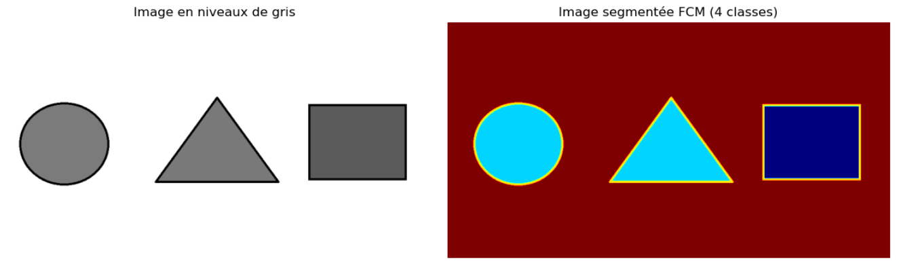
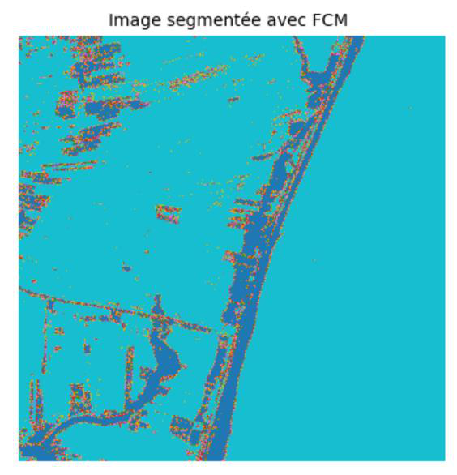
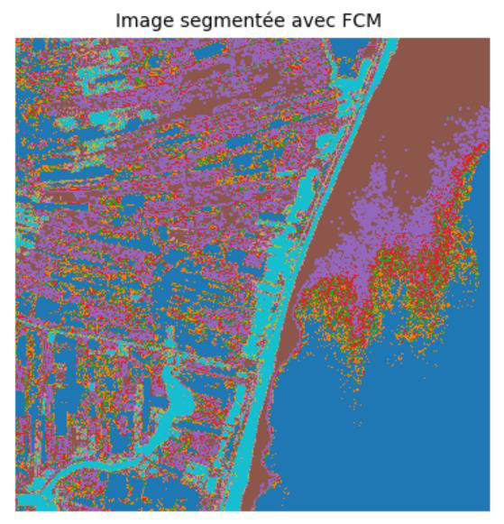
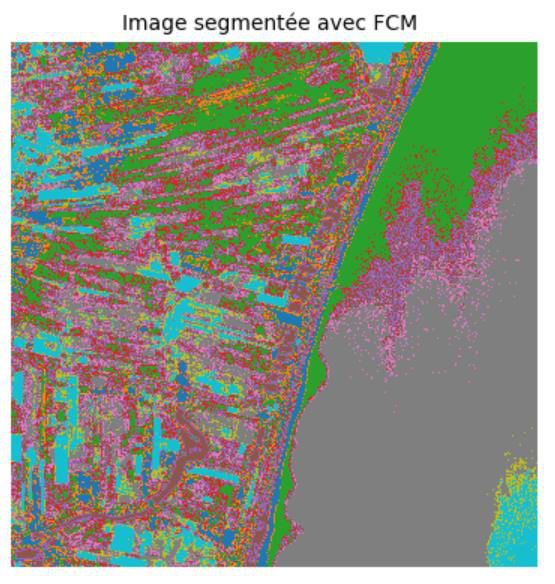

# Résultats et discussion

[← Retour au README](../../README.fr.md) · [English](../results.md)

## 1. Test de validité sur une image synthétique

Le Fuzzy C-Means avec 4 clusters (cercle, triangle, rectangle et fond) isole correctement les formes, ce qui valide l'implémentation avant de passer aux données réelles.

## 2. Image satellitaire : effet du nombre de clusters

Même image, mêmes paramètres (m = 1,7, ε = 1e-5), seul `k` change.

| k | Itérations jusqu'à convergence | Accuracy (%) |
|---|---|---|
| 2 | 39 | 49,28 |
| 3 | 73 | 51,61 |
| **4** | 110 | **52,55** |
| 5 | 124 | 49,24 |
| 6 | 271 ¹ | 45,13 |

¹ **271 itérations** est la valeur relevée par le notebook et donnée dans le texte du mémoire (le tableau récapitulatif du mémoire indique 262, ce qui ne correspond pas). L'initialisation étant aléatoire et sans graine, le nombre exact varie légèrement d'une exécution à l'autre.

### Cartes de segmentation

| k = 2 | k = 3 | k = 4 |
|:---:|:---:|:---:|
|  |  |  |

| k = 5 | k = 6 |
|:---:|:---:|
|  |  |

*Les couleurs sont des étiquettes de clusters arbitraires. L'image satellite et son masque ne sont pas affichés ici, voir [`data/README.md`](../../data/README.md).*

## 3. Discussion

1. **k = 4 donne le meilleur compromis** : il sépare les structures principales (eau, champs, littoral) sans fragmenter l'image, et atteint l'accuracy la plus élevée (52,55 %).
2. **Trop peu de clusters fusionnent des zones distinctes** (k = 2 et k = 3).
3. **Trop de clusters scindent des régions homogènes** (k = 5 et k = 6), et l'algorithme exige beaucoup plus d'itérations pour converger (271 pour k = 6 contre 39 pour k = 2).
4. **L'accuracy mesurée est modeste.** Le mémoire note lui-même qu'elle révèle des limites du Fuzzy C-Means : sensibilité au bruit, aux valeurs aberrantes et à l'initialisation aléatoire.

### Comment lire l'accuracy

* Le masque de vérité terrain comporte **quatre classes**, dont la plus grande couvre **57,42 %** de l'image. Un classifieur trivial qui prédirait toujours cette classe obtiendrait 57,42 %, soit plus que le meilleur score du Fuzzy C-Means. L'accuracy pixel à pixel est donc ici un **indicateur grossier**, pas une mesure complète de qualité ; des métriques par classe comme l'IoU ou le F1 seraient plus informatives.
* Avec un appariement un-pour-un, **tout k supérieur à 4 laisse des clusters sans classe de vérité terrain**. Cela abaisse mécaniquement l'accuracy pour k = 5 et k = 6, en plus de la sur-segmentation visuelle décrite dans le mémoire.
* L'algorithme ne voit qu'**un niveau de gris par pixel**. Les classes dont les niveaux de gris se recouvrent (par exemple sable clair et cultures claires) ne peuvent pas être séparées sans couleur, texture ou contexte spatial.

## 4. Enseignements

* Le Fuzzy C-Means est une base simple, sans étiquettes, qui produit une partition grossière plausible d'une scène satellitaire sans données d'entraînement.
* Les appartenances souples sont sa principale force ; l'absence d'**information spatiale** et la dépendance à l'**initialisation** sont ses principales faiblesses.
* Ces constats motivent les extensions listées dans le [README](../../README.fr.md#perspectives) : hybridation avec le **K-Means** (initialisation stable) et avec l'**apprentissage profond** (CNN), variantes du FCM intégrant l'espace, caractéristiques plus riches (bandes de couleur, texture).
