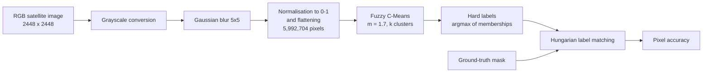

# Methodology

[← Back to README](../README.md) · [Français](fr/methodology.md)

This document describes the experimental protocol: data, pre-processing, algorithm settings, evaluation and reproducibility.

## 1. Pipeline

## 2. Data

* **Image**: one 2448 × 2448 RGB satellite tile (tile *606*), containing agricultural land on the left and a large water body on the right, separated by a coastline.
* **Ground truth**: a colour-coded mask of the same size, with **4 classes**. Once converted to grayscale, the mask has four values with the following pixel shares:

| Grayscale value | Share of pixels | Colour in the mask (visual reading) |
|---|---|---|
| 29 | 39.95 % | blue |
| 105 | 1.79 % | magenta |
| 226 | 57.42 % | yellow |
| 255 | 0.84 % | white |

* **Format**: the tile naming (`<id>_sat.jpg` / `<id>_mask.png`), the 2448 × 2448 size and the colour palette are consistent with the **DeepGlobe Land Cover Classification** dataset (Demir et al., CVPR Workshops 2018). The images are **not redistributed** in this repository: see [`data/README.md`](../data/README.md).
* **Synthetic image**: a hand-drawn image (circle, triangle, rectangle on a white background, `assets/synthetic_shapes.png`) used as a sanity check before processing real data.

## 3. Pre-processing

1. **Grayscale conversion** (`cv2.cvtColor`, BGR → GRAY): reduces each pixel to one intensity value.
2. **Gaussian blur**, 5 × 5 kernel (`cv2.GaussianBlur`): attenuates noise while keeping the main edges. After blurring, intensities range from 24 to 254.
3. **Normalisation** to [0, 1] (division by 255) so that distances are homogeneous, then **flattening** to a vector of 5,992,704 values.

## 4. Fuzzy C-Means settings

| Parameter | Value | Role |
|---|---|---|
| `k` (clusters) | 2 to 6 | Number of regions |
| `m` | 1.7 | Fuzziness index (higher = fuzzier) |
| `epsilon` | 1e-5 | Convergence threshold on ‖U_new − U‖ |
| `max_iter` | 100 / 150 in the first runs, 300 for k = 6 | Safety limit. With k = 6 the 150 limit was not enough, so it was raised to 300 |
| Initialisation | random (Dirichlet), no seed | Memberships of each pixel sum to 1 |
| Distance | absolute difference of intensities (1-D) | Euclidean distance in one dimension |

The implementation is written from scratch with NumPy (centroids by matrix product, memberships by broadcasting), as described in [theory](theory.md).

## 5. Evaluation

The masks give a **pixel-wise ground truth**, so the segmentation is scored with the **pixel accuracy**:

$$
\text{Accuracy} = \frac{\text{number of correctly labelled pixels}}{\text{total number of pixels}} \times 100
$$

Cluster identifiers are arbitrary (cluster 0 does not mean class 0), so before scoring, predicted clusters are **matched one-to-one with ground-truth classes** by maximising the overlap with the **Hungarian algorithm** (`scipy.optimize.linear_sum_assignment` on the confusion matrix).

## 6. Choosing the number of clusters

The same image is segmented with k = 2, 3, 4, 5 and 6. For each k, the number of iterations to convergence and the accuracy are recorded, and the visual quality of the regions is inspected (see [results](results.md)).

## 7. Reproducibility

| Item | Detail |
|---|---|
| Environment | Python 3.11, NumPy, OpenCV, Matplotlib, SciPy, scikit-learn (executed on Kaggle; see `requirements.txt`) |
| Randomness | **No seed is set.** Membership initialisation is random, so the number of iterations and the exact accuracy vary slightly between runs (for k = 6 the saved notebook converged after 271 iterations) |
| Run time | Pure NumPy on ~6 million pixels: each N × k matrix weighs a few hundred MB, so a machine with several GB of RAM is advisable |
| Data | Not included, see `data/README.md` |
